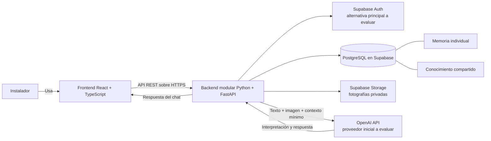
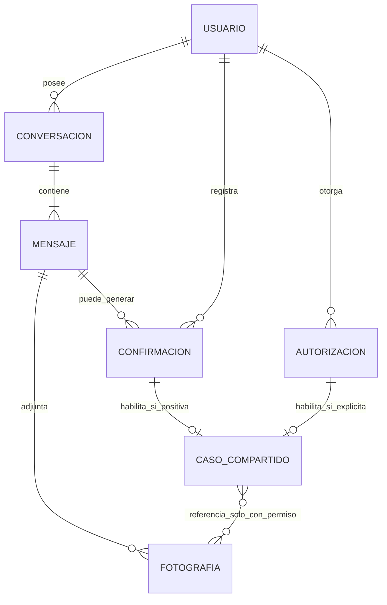
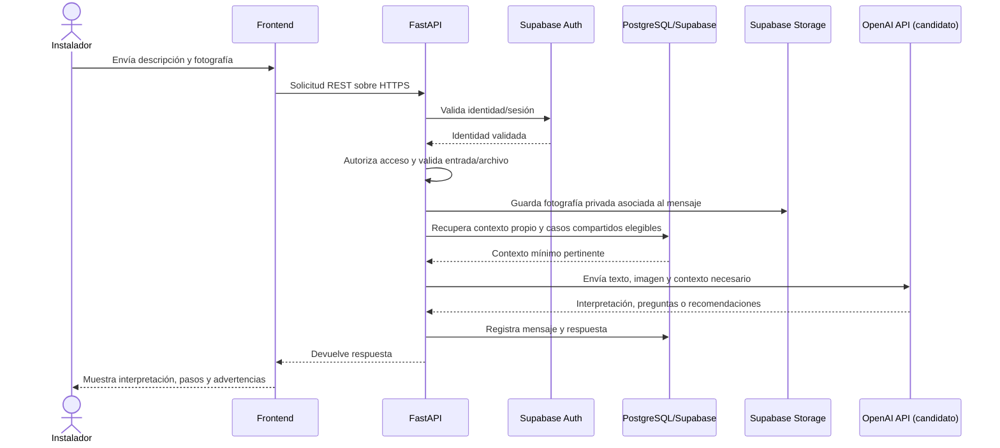
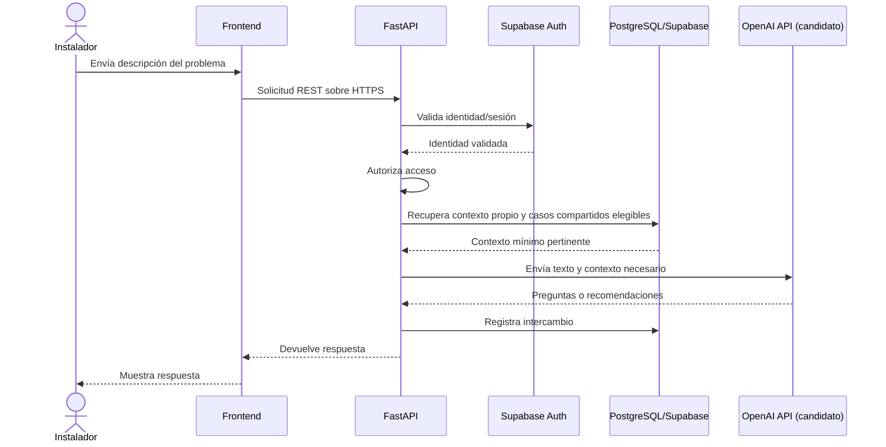
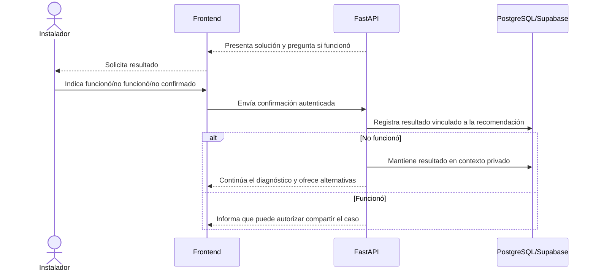
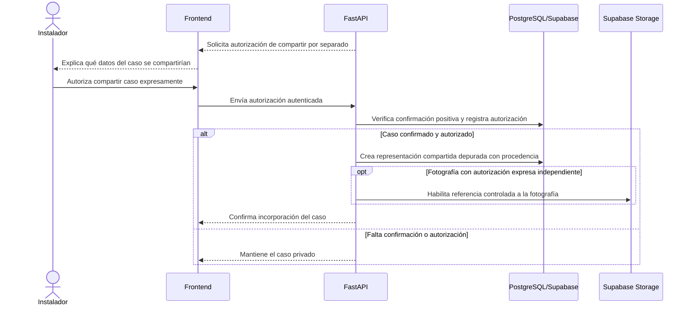

# Arquitectura técnica — SecureAssist AI

**Estado:** propuesta arquitectónica basada en las decisiones aprobadas en `AGENTS.md`  
**Alcance:** documentación de la primera versión; no define un esquema físico ni implementa componentes.

## 1. DESCRIPCIÓN GENERAL

### Propósito del sistema

SecureAssist AI será una aplicación web de asistencia técnica para instaladores de sistemas de seguridad electrónica. Permitirá describir problemas en lenguaje cotidiano, adjuntar fotografías y recibir orientación técnica conversacional.

### Problema que resuelve

Los instaladores pueden tener dificultades para describir fallas con términos técnicos, identificar el equipo implicado o encontrar pasos de diagnóstico. El sistema busca ayudarles a organizar la información, pedir datos faltantes y proponer acciones prácticas con contexto y advertencias.

### Alcance de la primera versión

La primera versión contempla exclusivamente el chatbot de asistencia técnica:

- Conversaciones en lenguaje natural.
- Recepción e interpretación multimodal de texto y fotografías.
- Preguntas de diagnóstico cuando falte información.
- Recomendaciones breves, ordenadas y alternativas cuando una solución no funcione.
- Memoria privada individual por instalador.
- Consulta de casos del conocimiento técnico compartido.
- Registro de resultados y confirmación del instalador.
- Incorporación de un caso compartido solo si el instalador confirma que la solución funcionó y autoriza expresamente compartir el caso.

### Funcionalidades fuera de alcance

El inventario de cámaras, accesorios, grabadores y otros equipos —incluidas existencias, cantidades y precios— queda para una etapa futura y no se desarrolla en este documento. Otras integraciones futuras requieren alcance y autorización específicos.

## 2. ARQUITECTURA GENERAL

### Monolito modular

La arquitectura inicial será un monolito modular: un backend desplegable como una aplicación, organizado en módulos con responsabilidades claras. La API, la lógica de conversación, la integración de IA y el acceso a datos se separan internamente sin operar como microservicios independientes.

Esta organización mantiene una estructura comprensible para la primera versión. La separación en microservicios no está aprobada ni se propone como requisito.

### Diagrama de componentes



### Comunicación y límites de confianza

- El navegador se comunica con FastAPI mediante API REST sobre HTTPS.
- FastAPI valida identidad y permisos antes de leer o modificar datos.
- El backend accede a PostgreSQL y Storage según la autorización establecida.
- Las credenciales de OpenAI se mantienen únicamente en el backend.
- Las fotografías son privadas por defecto. El backend entrega al modelo solo el contenido necesario para la consulta.
- El frontend no se conecta directamente a OpenAI ni recibe sus credenciales.

## 3. FRONTEND

### Responsabilidades de React y TypeScript

React y TypeScript conforman la interfaz web: muestran la conversación, recogen texto y fotografías, presentan estados de procesamiento y representan respuestas y preguntas. El frontend no determina permisos de datos ni guarda credenciales de proveedores.

### Componentes principales propuestos

- **Acceso y sesión:** vistas de autenticación integradas con la alternativa aprobada, Supabase Auth.
- **Conversación:** mensajes del instalador y respuestas del asistente.
- **Entrada de texto:** campo para describir el problema en lenguaje natural.
- **Adjuntos:** selección, vista previa y estado de las fotografías antes del envío.
- **Respuesta técnica:** interpretación, pasos, alternativas y advertencias.
- **Seguimiento de resultado:** controles para indicar si la solución funcionó.
- **Consentimiento para compartir:** acción expresa e independiente para compartir un caso y, por separado, fotografías de referencia.

Estos son componentes conceptuales; no prescriben una biblioteca de interfaz ni un diseño visual.

### Flujo de conversación

1. El instalador abre una conversación autenticada o continúa una existente propia.
2. Describe el problema y, opcionalmente, adjunta una fotografía.
3. La interfaz indica el estado de envío y procesamiento.
4. Presenta preguntas cuando el asistente requiere más datos o recomendaciones cuando cuenta con contexto suficiente.
5. El instalador prueba la recomendación e informa el resultado.

### Gestión de fotografías en la interfaz

La interfaz permite elegir y revisar la fotografía y asociarla al mensaje. Debe comunicar si el archivo está cargando o si ocurrió un error. La validación de seguridad y autorización definitiva corresponde al backend y al almacenamiento; el control en el navegador no sustituye esas validaciones.

## 4. BACKEND

### Responsabilidades de FastAPI

FastAPI expondrá la API REST y coordinará autenticación, autorización, persistencia, carga y consulta de fotografías, recuperación de contexto, llamadas al modelo y registro del resultado del instalador. Las operaciones sensibles se ejecutan del lado del servidor.

### Módulos propuestos

- **API:** rutas y validación de entradas/salidas HTTP.
- **Auth y autorización:** validación del usuario y control de acceso a recursos propios.
- **Conversaciones:** ciclo de vida de conversaciones y mensajes privados.
- **Media:** validación, metadatos y acceso a imágenes privadas.
- **AI:** adaptación de solicitudes y respuestas del proveedor multimodal.
- **Memoria:** recuperación del contexto individual pertinente.
- **Knowledge:** búsqueda de casos compartidos elegibles y registro de su procedencia.
- **Feedback:** confirmaciones de resultado y autorizaciones de compartir.
- **Persistence:** acceso a PostgreSQL y almacenamiento administrado.
- **Core/configuración:** configuración por entorno, errores comunes y utilidades transversales.

La estructura es una propuesta organizativa, no una definición final de clases, endpoints o contratos.

### Servicios externos

El backend utilizará Supabase para PostgreSQL, autenticación (alternativa principal a evaluar) y almacenamiento privado. OpenAI API será el primer proveedor evaluado para procesamiento multimodal. La integración concreta, modelo y modalidad de envío quedan pendientes de pruebas y aprobación.

### Gestión de errores

El backend debe distinguir, como mínimo, errores de autenticación/autorización, validación de archivos o entradas, indisponibilidad de servicios externos, límites de proveedor y fallas de persistencia. La respuesta al usuario debe ser comprensible y no incluir secretos, datos de otros usuarios ni detalles internos sensibles. Los fallos temporales no deben convertirse en diagnósticos técnicos inventados.

## 5. INTELIGENCIA ARTIFICIAL

### Integración prevista con OpenAI API

OpenAI API es el primer candidato a evaluar, no una selección definitiva. El backend será el único componente que mantendrá credenciales y realizará llamadas. Antes de decidir se evaluarán calidad técnica, costos y privacidad.

### Procesamiento de texto e imágenes

Cuando haya una imagen, el backend la asocia a la consulta del usuario y prepara texto, imagen y contexto pertinente para el modelo multimodal. Sin imagen, la solicitud incluirá texto y contexto. En ambos casos se debe limitar el contexto a lo necesario y evitar enviar historiales completos por defecto.

### Construcción del contexto

El contexto de una solicitud puede componerse de:

- El mensaje actual del instalador.
- Los mensajes recientes o el resumen pertinente de su conversación privada.
- Información recordada de ese instalador que sea relevante.
- Casos pertinentes del conocimiento compartido que cumplan los criterios de publicación.
- La fotografía actual, si existe.

La memoria privada y la base compartida son fuentes distintas. El acceso a una no concede acceso a la otra.

### Diagnóstico y recomendaciones

El asistente debe identificar información faltante y hacer preguntas de diagnóstico antes de recomendar acciones que dependan de esos datos. Cuando haya suficiente información, presenta pasos concisos y ordenados y puede proponer alternativas tras un resultado fallido.

### Incertidumbre y seguridad

El sistema debe reconocer que no tiene evidencia suficiente, no inventar especificaciones y comunicar límites de la interpretación visual. Las instrucciones deben advertir sobre riesgos eléctricos y de seguridad cuando sean pertinentes. Un caso compartido confirmado por un instalador es evidencia de ese caso, no garantía para otros equipos o condiciones.

## 6. MEMORIA INDIVIDUAL

### Identificación del instalador

Cada dato privado debe vincularse a la identidad autenticada del instalador, obtenida y validada en el backend. No se confiará en un identificador de usuario enviado libremente por el navegador como prueba de acceso.

Supabase Auth es la alternativa principal aprobada para evaluar la autenticación. El método de inicio de sesión y el flujo de sesión concretos siguen pendientes.

### Información que puede recordar

De acuerdo con `AGENTS.md`, la memoria puede conservar conversaciones y contexto de problemas, equipos mencionados y soluciones utilizadas para evitar preguntas repetitivas y adaptar la asistencia. No debe retener información personal innecesaria.

### Recuperación y privacidad

Para cada solicitud se recuperará solo el contexto necesario y pertinente del instalador autenticado. La memoria no se expone a otros instaladores ni se copia automáticamente a la base compartida. Las reglas definitivas de retención y eliminación de conversaciones también deben aprobarse.

## 7. CONOCIMIENTO TÉCNICO COMPARTIDO

### Estructura conceptual de un caso

Un caso puede contener problema, descripción del equipo, diagnóstico, preguntas pertinentes, solución propuesta, resultado, confirmación del instalador, procedencia y fechas relevantes. Solo se compartirán los datos necesarios; no se publicará la conversación privada original.

### Confirmación y autorización

La confirmación de que una solución funcionó y la autorización para compartir son acciones separadas. Ambas deben estar registradas para que el caso sea elegible para incorporación. Una confirmación negativa se registra como resultado de la conversación privada y conduce a alternativas; por sí sola no habilita compartir el caso como solución confirmada.

### Recuperación de casos

El backend recuperará casos compartidos pertinentes para la consulta. El mecanismo de similitud (por ejemplo, búsqueda textual o semántica) queda pendiente de decisión y validación. Las respuestas deben preservar la procedencia y el contexto técnico del caso recuperado.

### Estados conceptuales

- **Privado/no compartido:** caso o consulta accesible en su contexto individual, sin estar disponible en la base compartida.
- **Confirmado por el instalador:** el instalador reportó que la solución funcionó en su caso.
- **Compartido autorizado:** además de la confirmación, existe autorización expresa para compartir el caso.
- **Resultado no resuelto:** la solución no funcionó o no se ha confirmado; no se presenta como solución compartida confirmada.

Los estados son conceptos para documentar el comportamiento. Los valores físicos y transiciones se definirán posteriormente.

## 8. GESTIÓN DE FOTOGRAFÍAS

1. **Recepción:** el instalador adjunta una imagen al mensaje; el backend asocia el archivo con el usuario y la conversación correspondiente.
2. **Validación:** el backend verifica tipo y tamaño permitidos, entre otras reglas que se definan antes de implementación. Los parámetros concretos están pendientes.
3. **Almacenamiento privado:** se utiliza Supabase Storage con acceso restringido. Las fotografías no son públicas por defecto.
4. **Envío al modelo:** el backend transmite la imagen necesaria para analizar la consulta a OpenAI API u otro proveedor aprobado. El modelo elegido y los detalles de transferencia dependen de la evaluación de privacidad y costos.
5. **Autorización para compartir:** compartir el caso no autoriza automáticamente compartir sus fotografías. Cada fotografía de referencia requiere autorización expresa.
6. **Conservación y eliminación:** se debe aprobar una política que determine plazos, eliminación solicitada, copias de respaldo y comportamiento al retirar una autorización. La política no está definida en este documento.

## 9. BASE DE DATOS

Este es un modelo conceptual. No define tablas físicas, columnas, restricciones ni migraciones SQL.

### Entidades conceptuales

- **Usuario/instalador:** identidad autenticada y atributos mínimos necesarios.
- **Conversación:** interacción privada perteneciente a un instalador.
- **Mensaje:** entrada del instalador o respuesta del asistente dentro de una conversación, con orden temporal y tipo.
- **Fotografía:** referencia y metadatos del archivo asociado a un mensaje; el contenido binario reside en almacenamiento privado.
- **Confirmación de resultado:** respuesta del instalador sobre si una recomendación funcionó, vinculada al contexto de recomendación y con fecha.
- **Autorización de compartir:** evidencia de que el instalador autorizó compartir un caso; autorización de caso y autorización de fotografía deben poder distinguirse.
- **Caso técnico compartido:** representación depurada del problema, equipo, diagnóstico, solución, resultado y procedencia, elegible solo tras confirmación positiva y autorización expresa.

### Relaciones conceptuales



Las relaciones del diagrama expresan conceptos y elegibilidad, no una solución física cerrada. La trazabilidad interna debe protegerse para no revelar a otros usuarios la conversación privada de origen. La confirmación y la autorización son evidencias independientes; ambas son necesarias para compartir el caso.

## 10. SEGURIDAD

### Autenticación

Supabase Auth es la alternativa principal a evaluar. El backend validará la identidad autenticada en cada operación protegida. El mecanismo concreto de sesión y validación debe aprobarse al decidir la configuración.

### Autorización

El backend debe comprobar la propiedad o permiso de cada conversación, mensaje, fotografía y confirmación. La ocultación de elementos en la interfaz no es control de acceso.

### Row Level Security

Se evaluarán y configurarán políticas RLS en PostgreSQL/Supabase para reforzar el aislamiento por usuario y controlar el acceso al conocimiento compartido. Las políticas específicas, roles y operaciones permitidas están pendientes de diseño y validación. RLS no reemplaza la autorización correcta en el backend.

### Credenciales

Las credenciales de OpenAI y secretos de servicio permanecen en el backend y en configuración segura del entorno. No se incluyen en el frontend, el repositorio ni logs. El acceso a credenciales debe limitarse a los componentes que las necesiten.

### Privacidad y aislamiento

- La memoria individual y el conocimiento compartido permanecen separados.
- La información privada no se hace visible a otros instaladores.
- Los archivos son privados por defecto y se acceden mediante controles autorizados.
- Los casos compartidos contienen solo información autorizada y necesaria.
- Los logs no deben replicar conversaciones, imágenes, tokens ni secretos sin una necesidad aprobada.

## 11. FLUJOS DEL SISTEMA

### Consulta técnica con fotografía



### Consulta sin fotografía



### Confirmación de una solución



### Incorporación autorizada de un caso al conocimiento compartido



## 12. ESTRUCTURA DEL PROYECTO

Propuesta organizativa; las carpetas frontend y backend del esquema son propuestas y no se han creado. La carpeta docs/architecture contiene este documento. El esquema tampoco implica decisiones de herramientas de construcción específicas.

```text
secureassist-ai/
├── frontend/
│   └── src/
│       ├── app/                 # Composición principal y navegación
│       ├── components/
│       │   ├── chat/            # Mensajes y conversación
│       │   ├── media/           # Selección y vista previa de fotografías
│       │   └── feedback/        # Confirmación y autorización
│       ├── pages/               # Vistas de la aplicación
│       ├── services/            # Cliente de API REST y sesión
│       ├── types/               # Tipos compartidos del frontend
│       └── styles/              # Estilos de presentación
├── backend/
│   └── app/
│       ├── api/                 # Enrutamiento y contratos HTTP
│       ├── auth/                # Identidad y autorización
│       ├── conversations/       # Conversaciones y mensajes privados
│       ├── media/               # Validación y Storage
│       ├── ai/                  # Adaptador al proveedor multimodal
│       ├── memory/              # Contexto individual
│       ├── knowledge/           # Casos compartidos y recuperación
│       ├── feedback/            # Resultados y autorizaciones
│       ├── persistence/         # Acceso a PostgreSQL/Supabase
│       └── core/                # Configuración, errores y utilidades
├── docs/
│   └── architecture/            # Documentación de arquitectura
└── README.md                    # Objetivo, alcance y guía del proyecto
```

## 13. DECISIONES PENDIENTES

Las siguientes definiciones no están cerradas por `AGENTS.md` y requieren evaluación o aprobación antes de implementarse:

1. Modelo multimodal concreto, modalidad de API y resultados de evaluación de OpenAI frente a los criterios aprobados de costo, calidad y privacidad.
2. Costos objetivo, presupuesto y volumen esperado de usuarios, consultas e imágenes.
3. Método de autenticación y configuración final de Supabase Auth.
4. Diseño y pruebas de políticas RLS, roles y matriz de permisos para datos privados y compartidos.
5. Política de conservación y eliminación de conversaciones, fotografías, respaldos y registros; también cómo se revoca una autorización.
6. Límites de tamaño, formatos aceptados y reglas de validación de fotografías.
7. Cómo se depuran los casos para compartir y qué campos se muestran como procedencia sin revelar la conversación privada.
8. Si la autorización de compartir será por caso y cómo se gestionará una autorización posterior o retirada.
9. Autorización independiente para cada fotografía y comportamiento si se retira.
10. Mecanismo de búsqueda de casos (texto, filtros u opción semántica) y criterio de relevancia.
11. Contratos y formatos de respuesta del backend y del adaptador de IA.
12. Experiencia del usuario para resultados fallidos, aún no confirmados y casos elegibles para compartir.
13. Plataforma de alojamiento del frontend y backend, monitoreo y proceso de publicación.

La aprobación de esta documentación no resuelve automáticamente esos puntos ni autoriza implementación, migraciones o publicación.

