# SecureAssist AI — Modelo de datos del MVP

**Versión:** 1.0 — propuesta para revisión  
**Estado:** diseño lógico para PostgreSQL mediante Supabase. No se ejecutó SQL ni se crearon tablas.  
**Fuentes:** AGENTS.md, arquitectura-tecnica.md, comportamiento-chatbot.md y requisitos-funcionales-mvp.md.

## 1. Propósito y alcance

Este modelo representa la información necesaria para autenticar instaladores, conservar conversaciones privadas con varios problemas independientes, adjuntar fotografías, registrar hipótesis/recomendaciones/resultados, mantener memoria individual y consultar casos técnicos que hayan sido confirmados y autorizados.

No modela inventario comercial, catálogo, precios, existencias, compras, ventas, proveedores ni cotizaciones. Los equipos descritos son menciones contextuales de instalaciones y diagnósticos, no productos de inventario.

> **Actualización 2026-11-19:** las tablas del inventario para reparaciones (`products`, `stock_locations`, `stock_levels`, `stock_movements`, `clients`, `installed_equipment`, `repairs`) y `app_users` con roles se documentan aparte. Las entidades de este documento no cambian. Ver [inventario-y-asistente.md](inventario-y-asistente.md).

La arquitectura sigue siendo un monolito modular con React + TypeScript, Python + FastAPI, REST sobre HTTPS, PostgreSQL mediante Supabase, Supabase Auth como alternativa principal a evaluar y Supabase Storage privado. OpenAI API sigue siendo proveedor inicial a evaluar, no selección definitiva. Este documento no crea endpoints, migraciones, políticas ejecutables ni SQL.

## 2. Principios del modelo

### 2.1 Identidad y datos privados

- Supabase Auth mantiene las credenciales y la identidad autenticada.
- El perfil propio referencia exactamente el UUID de auth.users; no hay tabla propia de contraseñas ni roles administrativos.
- Cada fila privada tiene propietario explícito o pertenece a un padre que tiene propietario. Varias tablas repiten owner_user_id intencionalmente para simplificar RLS e impedir referencias cruzadas mediante claves foráneas compuestas.
- No confiar en IDs enviados por el navegador para determinar propiedad.
- Memoria individual, conversación original, registros de diagnóstico y archivos quedan en el dominio privado del instalador.

### 2.2 Separación de conversación, problema y mensaje

Una conversación contiene muchos mensajes y puede contener varios problemas. La relación mensaje-problema es muchos-a-muchos mediante MESSAGE_ISSUES: un mensaje puede iniciar o referirse a más de un problema, y un problema puede usar múltiples mensajes como evidencia. Esto evita mezclar equipos, síntomas, acciones y resultados.

### 2.3 Historial frente a memoria

El historial conserva mensajes y actividades tal como ocurrieron. MEMORY_ITEMS conserva solo hechos técnicos resumidos y útiles, vinculados a su fuente. No es copia de la conversación ni se publica automáticamente.

### 2.4 Caso privado frente a conocimiento compartido

TECHNICAL_CASES enlaza el problema privado con el resultado positivo que el instalador confirmó. SHARED_CASE_VERSIONS guarda una copia depurada y versionada del contenido exacto que se propone compartir. La copia compartida no contiene la conversación original ni datos de identidad del instalador. CASE_PUBLICATION_PROVENANCE conserva la relación de origen solo para el backend autorizado.

Para compartir texto deben existir un CHECK_RESULT de éxito completo y una autorización expresa vigente para esa versión. La autorización de fotografías es independiente. La ausencia de autorización nunca equivale a permiso.

### 2.5 Normalización y tipos

Se recomienda UUID como clave primaria, timestamptz para fechas, bigint para tamaño de archivo y text con restricciones CHECK para estados controlados. Los estados de negocio aquí descritos son propuesta de dominio; deben revisarse antes de migración. No se recomienda JSONB en el MVP: hipótesis, desconocidos, equipos, acciones, resultados, consentimientos y eventos tienen relaciones explícitas. Campos de error solo guardan códigos y mensajes seguros, nunca stack traces, prompts completos, credenciales o contenido innecesario.

## 3. Entidades y dominios

| Dominio | Entidades |
|---|---|
| Identidad | AUTH.USERS (administrada por Supabase), INSTALLER_PROFILES |
| Conversación e incidencias | CONVERSATIONS, MESSAGES, TECHNICAL_ISSUES, MESSAGE_ISSUES |
| Equipos mencionados | EQUIPMENT_MENTIONS, ISSUE_EQUIPMENT |
| Diagnóstico | ISSUE_UNKNOWNS, ISSUE_HYPOTHESES, HYPOTHESIS_EVIDENCE, ISSUE_STATUS_EVENTS |
| Recomendaciones | RECOMMENDATIONS, RECOMMENDATION_STEPS, CHECK_RESULTS |
| Archivos | MEDIA_ASSETS, ISSUE_MEDIA (el binario está en Supabase Storage) |
| Memoria personal | MEMORY_ITEMS |
| Casos compartidos | TECHNICAL_CASES, SHARED_CASES, SHARED_CASE_VERSIONS, SHARED_CASE_EQUIPMENT, SHARED_CASE_STEPS |
| Consentimiento y trazabilidad | CASE_TEXT_CONSENT_EVENTS, PHOTO_CONSENT_EVENTS, SHARED_CASE_PHOTOS, CASE_PUBLICATION_PROVENANCE, SHARED_CASE_EVENTS |

## 4. Relaciones, cardinalidades y eliminación

### Relaciones principales

| Origen | Destino | Cardinalidad | Claves y propósito |
|---|---|---|---|
| AUTH.USERS | INSTALLER_PROFILES | 1 a 0..1 | profile.user_id es PK y FK a auth.users.id. |
| INSTALLER_PROFILES | CONVERSATIONS | 1 a muchos | conversations.owner_user_id referencia perfil. |
| CONVERSATIONS | MESSAGES | 1 a muchos | mensaje pertenece a conversación y dueño. |
| CONVERSATIONS | TECHNICAL_ISSUES | 1 a muchos | problemas independientes bajo la misma conversación. |
| MESSAGES | TECHNICAL_ISSUES | muchos a muchos | MESSAGE_ISSUES registra el propósito de la relación. |
| MESSAGES | MEDIA_ASSETS | 1 a muchos | cada adjunto pertenece al mensaje que lo recibió. |
| TECHNICAL_ISSUES | MEDIA_ASSETS | muchos a muchos | ISSUE_MEDIA vincula explícitamente imágenes con problemas. |
| MESSAGES | EQUIPMENT_MENTIONS | 1 a muchos | mención de equipo con fuente verificable. |
| TECHNICAL_ISSUES | EQUIPMENT_MENTIONS | muchos a muchos | ISSUE_EQUIPMENT permite equipo compartido entre problemas del mismo usuario. |
| TECHNICAL_ISSUES | ISSUE_UNKNOWNS / ISSUE_HYPOTHESES / RECOMMENDATIONS / ISSUE_STATUS_EVENTS | 1 a muchos | datos diagnósticos privados. |
| ISSUE_HYPOTHESES | HYPOTHESIS_EVIDENCE | 1 a muchos | fuentes que apoyan, debilitan o dejan abierta una hipótesis. |
| RECOMMENDATIONS | RECOMMENDATION_STEPS / CHECK_RESULTS | 1 a muchos | acciones con pasos ordenados y múltiples reportes de resultado a lo largo del tiempo. |
| INSTALLER_PROFILES | MEMORY_ITEMS | 1 a muchos | memoria técnica solo del propietario. |
| TECHNICAL_ISSUES | TECHNICAL_CASES | 1 a 0..1 propuesto | expediente privado creado después de confirmar resolución completa. |
| TECHNICAL_CASES | CASE_TEXT_CONSENT_EVENTS | 1 a muchos | historial inmutable de decisión para compartir texto/versiones. |
| TECHNICAL_CASES | SHARED_CASES | 1 a 0..1 vigente | origen privado separado de publicación depurada. |
| SHARED_CASES | SHARED_CASE_VERSIONS | 1 a muchos | revisiones del material que puede compartirse. |
| SHARED_CASE_VERSIONS | SHARED_CASE_EQUIPMENT / SHARED_CASE_STEPS | 1 a muchos | snapshot depurado de equipos y pasos/resultados. |
| MEDIA_ASSETS | PHOTO_CONSENT_EVENTS | 1 a muchos | permisos por imagen/versiones; texto no concede permiso de foto. |
| SHARED_CASE_VERSIONS | SHARED_CASE_PHOTOS | 1 a muchos | solo referencias con permiso vigente, entregadas por backend. |
| SHARED_CASE_VERSIONS | CASE_PUBLICATION_PROVENANCE | 1 a 1 por publicación | referencia privada a caso de origen y evento de consentimiento de texto. |
| SHARED_CASES | SHARED_CASE_EVENTS | 1 a muchos | registro de publicación, revisión y retiro. |

### Integridad entre propietario y padre

Las tablas hijas con owner_user_id deben tener una clave candidata compuesta en su padre (por ejemplo, id + owner_user_id) y una FK compuesta que incluya ambos valores. En MESSAGE_ISSUES, ISSUE_MEDIA, ISSUE_EQUIPMENT y relaciones de evidencia también se incluye conversation_id cuando se requiere demostrar que ambos recursos pertenecen a la misma conversación. Es una duplicación de clave deliberada para integridad/RLS, no duplicación del contenido del mensaje o equipo. En CASE_TEXT_CONSENT_EVENTS y CASE_PUBLICATION_PROVENANCE se deben usar FKs compuestas para verificar que la versión consentida pertenece al SHARED_CASES derivado del mismo TECHNICAL_CASES; el evento de consentimiento y la versión deben coincidir en caso, propietario y contenido.

### Comportamiento propuesto ante eliminación

La política de retención no está aprobada. Hasta aprobarla:

- Las filas de conversación, problema, recomendación, resultado, permiso y publicación no deben borrarse por cascada al eliminar auth.users o un padre.
- Recomendar ON DELETE RESTRICT para datos con trazabilidad y cierre lógico mediante estado/fecha. No exponer eliminación directa de estas filas al cliente.
- ON DELETE CASCADE puede reservarse para filas de asociación puras (MESSAGE_ISSUES, ISSUE_EQUIPMENT, ISSUE_MEDIA) solo dentro de una eliminación coordinada y aprobada de sus padres.
- Consentimientos y eventos de publicación son append-only: una revocación crea evento nuevo y no reemplaza ni borra la concesión previa.
- El retiro de un caso cambia su estado de publicación inmediatamente para excluirlo de búsquedas. La eliminación física de versiones, objetos y respaldos se procesa según política posterior; no se declara terminada antes de verificarla.
- MEDIA_ASSETS mantiene removed_at y estado de archivo. Retirar foto compartida elimina su vínculo/servicio compartido y deja el original privado, salvo que exista una solicitud y política aprobada de eliminación del original.
- Borrado de cuenta, anonimización, tiempos de retención, backups y cascadas finales son decisiones pendientes. La FK a auth.users no debe provocar pérdida accidental ni dejar filas huérfanas.

## 5. Diccionario de datos

### Notación

- **PK:** clave primaria; **FK:** clave foránea; **UQ:** única; **CK:** restricción de dominio/consistencia propuesta.
- **P:** privado del instalador; **S:** proyección compartida autorizada para usuarios autenticados; **R:** restringido al backend/trazabilidad; **E:** administrado por Supabase Auth.
- Todos los UUID propios se proponen con generación del lado de PostgreSQL. Timestamps son timestamptz y se guardan en UTC.
- Los nombres de estado son vocabularios propuestos a implementar como text + CHECK, no migraciones listas para ejecutar.

### AUTH.USERS (externa, administrada por Supabase)

No se crea ni modifica esta tabla. Supabase Auth es fuente de identidad y credenciales; el modelo solo referencia su identificador.

| Atributo | Tipo / nulabilidad | Clave y regla | Significado / acceso |
|---|---|---|---|
| id | uuid, NOT NULL | PK externa | Identificador Auth; no contraseña ni perfil del chatbot. E |

### INSTALLER_PROFILES

| Atributo | Tipo / nulabilidad | Clave y regla | Significado / acceso |
|---|---|---|---|
| user_id | uuid, NOT NULL | PK, FK auth.users.id | Misma identidad de Supabase Auth. P |
| display_name | text, NULL | Longitud razonable validada por aplicación | Nombre mostrado; dato opcional. P |
| account_state | text, NOT NULL | CK: active, closure_pending, closed; default active | Estado funcional de la cuenta, no rol ni copia de estado de contraseña/Auth. P |
| created_at | timestamptz, NOT NULL | default now() | Alta de perfil. P |
| updated_at | timestamptz, NOT NULL | default now(), actualizado por servidor | Último cambio de perfil. P |

No se almacenan email, contraseña, MFA ni secretos aquí si Supabase Auth ya es su fuente de verdad. La política de cierre/eliminación se debe aprobar.

### CONVERSATIONS

| Atributo | Tipo / nulabilidad | Clave y regla | Significado / acceso |
|---|---|---|---|
| id | uuid, NOT NULL | PK | Conversación. P |
| owner_user_id | uuid, NOT NULL | FK INSTALLER_PROFILES; UQ con id | Propietario para RLS. P |
| title | text, NULL | Texto breve; generado desde inicio sin datos innecesarios | Etiqueta del historial. P |
| state | text, NOT NULL | CK: open, closed, archived, deletion_pending, deleted; default open | Estado de uso/historial, no estado del diagnóstico. P |
| created_at | timestamptz, NOT NULL | default now() | Inicio. P |
| updated_at | timestamptz, NOT NULL | actualizado por servidor | Cambio de metadatos/estado. P |
| last_activity_at | timestamptz, NOT NULL | default now(); índice por propietario | Orden del historial; se actualiza al registrar mensaje. P |
| deleted_at | timestamptz, NULL | Requiere estado deleted/deletion_pending según política | Retiro lógico; no significa purga física. P |

### MESSAGES

| Atributo | Tipo / nulabilidad | Clave y regla | Significado / acceso |
|---|---|---|---|
| id | uuid, NOT NULL | PK; UQ con conversation_id y owner_user_id | Mensaje. P |
| conversation_id | uuid, NOT NULL | FK compuesta a CONVERSATIONS | Conversación contenedora. P |
| owner_user_id | uuid, NOT NULL | FK compuesta al propietario de conversación | RLS y consistencia. P |
| role | text, NOT NULL | CK: installer, assistant | Emisor; no guardar prompts del sistema como conversación de usuario. P |
| content_text | text, NULL | CHECK de aplicación: texto no vacío o adjunto válido | Texto visible; nullable para adjunto sin texto. P |
| processing_state | text, NOT NULL | CK: received, queued, processing, completed, failed, not_applicable | Estado de procesamiento, no resultado técnico. P |
| error_code | text, NULL | Código estable y seguro; nunca stack trace | Motivo resumido de error. P/R |
| ai_provider | text, NULL | Valor mínimo permitido, p. ej. proveedor usado | Trazabilidad técnica de mensaje del asistente; no credencial. P/R |
| ai_model | text, NULL | Identificador de modelo, si se necesita | Reproducibilidad/costo; no prompt. P/R |
| created_at | timestamptz, NOT NULL | default now(); UQ con id/conversation | Orden temporal. P |
| processed_at | timestamptz, NULL | Null hasta completar/fallar | Fin de procesamiento. P |

No almacenar razonamiento interno, prompt completo, tokens, secreto ni texto duplicado de la respuesta en otra tabla. Si hay imagen sin texto, el backend comprueba existencia de MEDIA_ASSETS antes de aceptar el turno.

### TECHNICAL_ISSUES

| Atributo | Tipo / nulabilidad | Clave y regla | Significado / acceso |
|---|---|---|---|
| id | uuid, NOT NULL | PK; UQ con conversation_id/owner_user_id | Problema independiente. P |
| conversation_id | uuid, NOT NULL | FK compuesta a CONVERSATIONS | Conversación que contiene el problema. P |
| owner_user_id | uuid, NOT NULL | Mismo dueño de conversación; índice RLS | Propietario privado. P |
| initial_symptom | text, NOT NULL | Texto original del síntoma; validación de no vacío | Relato inicial, no diagnóstico. P |
| interpreted_description | text, NULL | Actualización controlada | Reformulación revisable por el instalador. P |
| state | text, NOT NULL | CK: intake, diagnosing, awaiting_input, awaiting_result, partial_improvement, temporary_improvement, resolved_confirmed, escalated, closed; default intake | Estado actual. Parcial/temporal no es resuelto. P |
| started_at | timestamptz, NOT NULL | default now() | Inicio del problema. P |
| updated_at | timestamptz, NOT NULL | Actualizado por servidor | Último cambio. P |
| resolved_at | timestamptz, NULL | Solo tras confirmación completa | Fecha de confirmación reportada. P |

Las hipótesis y desconocidos se normalizan en sus propias tablas. Cambios de estado se conservan en ISSUE_STATUS_EVENTS.

### MESSAGE_ISSUES

| Atributo | Tipo / nulabilidad | Clave y regla | Significado / acceso |
|---|---|---|---|
| conversation_id | uuid, NOT NULL | Parte PK/FK compuesta | Comprueba misma conversación. P |
| owner_user_id | uuid, NOT NULL | Parte PK/FK compuesta | Comprueba mismo instalador. P |
| message_id | uuid, NOT NULL | Parte PK/FK a MESSAGES | Mensaje vinculado. P |
| issue_id | uuid, NOT NULL | Parte PK/FK a TECHNICAL_ISSUES | Problema vinculado. P |
| relation_type | text, NOT NULL | CK: initial, diagnostic, follow_up, related | Papel del mensaje en el problema. P |
| linked_at | timestamptz, NOT NULL | default now() | Trazabilidad de asociación. P |

PK propuesta: message_id + issue_id. Un mensaje puede mapear a varios problemas cuando su contenido realmente los aborda; el backend no debe asociarlo a todos por defecto.

### EQUIPMENT_MENTIONS

| Atributo | Tipo / nulabilidad | Clave y regla | Significado / acceso |
|---|---|---|---|
| id | uuid, NOT NULL | PK; UQ con owner_user_id | Mención contextual, no producto comercial. P |
| owner_user_id | uuid, NOT NULL | FK perfil | Propietario. P |
| conversation_id | uuid, NOT NULL | FK a conversación del mismo dueño | Contexto. P |
| source_message_id | uuid, NOT NULL | FK a mensaje del mismo dueño/conversación | Procedencia de la mención. P |
| equipment_type | text, NULL | Texto normalizado si se puede identificar | Tipo de equipo (cámara, DVR/NVR, switch, etc.). P |
| technical_category | text, NULL | Texto técnico; vocabulario pendiente | Categoría, no catálogo de ventas. P |
| manufacturer | text, NULL | Sin inferir | Fabricante si se conoce. P |
| brand | text, NULL | Sin inferir | Marca reportada/visible. P |
| model | text, NULL | Sin inferir | Modelo reportado/visible. P |
| identifier_description | text, NULL | Evitar serial/credenciales salvo necesidad aprobada | Identificación descriptiva mínima. P |
| created_at | timestamptz, NOT NULL | default now() | Alta de mención. P |
| updated_at | timestamptz, NOT NULL | Actualizado por servidor | Corrección/actualización. P |

### ISSUE_EQUIPMENT

| Atributo | Tipo / nulabilidad | Clave y regla | Significado / acceso |
|---|---|---|---|
| owner_user_id | uuid, NOT NULL | Parte PK y FK de coherencia | Mismo usuario. P |
| issue_id | uuid, NOT NULL | Parte PK/FK a problema propietario | Problema. P |
| equipment_mention_id | uuid, NOT NULL | Parte PK/FK a mención del mismo usuario | Equipo relacionado. P |
| relation_type | text, NOT NULL | CK: affected, related, recorder, network, power_source, unknown | Relación del equipo con el problema. P |
| linked_at | timestamptz, NOT NULL | default now() | Fecha de asociación. P |

PK propuesta: issue_id + equipment_mention_id. No contiene SKU, existencias, precio, compras ni stock.

### ISSUE_UNKNOWNS

| Atributo | Tipo / nulabilidad | Clave y regla | Significado / acceso |
|---|---|---|---|
| id | uuid, NOT NULL | PK; UQ id/issue/owner | Dato aún desconocido. P |
| issue_id | uuid, NOT NULL | FK al problema propietario | Problema. P |
| owner_user_id | uuid, NOT NULL | FK compuesta mismo dueño | Aislamiento. P |
| unknown_item | text, NOT NULL | No rellenar por inferencia | Qué dato falta. P |
| question_text | text, NULL | Pregunta efectivamente formulada | Trazabilidad de aclaración. P |
| state | text, NOT NULL | CK: pending, answered, unavailable, no_longer_relevant | Ciclo del dato. P |
| answer_message_id | uuid, NULL | FK al mensaje del mismo dueño/conversación | Fuente de respuesta, si existe. P |
| created_at | timestamptz, NOT NULL | default now() | Alta. P |
| resolved_at | timestamptz, NULL | Requerido al cerrar según estado | Fecha de respuesta/cierre. P |

### ISSUE_HYPOTHESES

| Atributo | Tipo / nulabilidad | Clave y regla | Significado / acceso |
|---|---|---|---|
| id | uuid, NOT NULL | PK; UQ id/issue/owner | Hipótesis. P |
| issue_id | uuid, NOT NULL | FK al problema propietario | Problema al que aplica. P |
| owner_user_id | uuid, NOT NULL | FK compuesta al propietario | Aislamiento. P |
| description | text, NOT NULL | Formulada como posibilidad, no hecho | Hipótesis actual. P |
| state | text, NOT NULL | CK: candidate, supported, weakened, rejected, unverified | Estado epistemológico; no es diagnóstico confirmado. P |
| created_at | timestamptz, NOT NULL | default now() | Creación. P |
| updated_at | timestamptz, NOT NULL | Actualizado por servidor | Revisión según evidencia. P |

### HYPOTHESIS_EVIDENCE

| Atributo | Tipo / nulabilidad | Clave y regla | Significado / acceso |
|---|---|---|---|
| id | uuid, NOT NULL | PK | Evidencia asociada. P |
| hypothesis_id | uuid, NOT NULL | FK a hipótesis del mismo problema/usuario | Hipótesis evaluada. P |
| issue_id | uuid, NOT NULL | FK compuesta problema | Verifica ámbito. P |
| owner_user_id | uuid, NOT NULL | FK compuesta propietario | Aislamiento. P |
| source_message_id | uuid, NOT NULL | FK a mensaje asociado al mismo problema | Fuente textual/foto señalada por su mensaje. P |
| evidence_kind | text, NOT NULL | CK: installer_report, visual_observation, check_result, other_observation | Tipo de evidencia, no conclusión. P |
| evidence_note | text, NOT NULL | Resumen mínimo, no duplicar conversación | Qué observación se considera relevante. P |
| created_at | timestamptz, NOT NULL | default now() | Fecha. P |

La asociación del mensaje al problema debe verificarse mediante MESSAGE_ISSUES en la misma transacción.

### RECOMMENDATIONS

| Atributo | Tipo / nulabilidad | Clave y regla | Significado / acceso |
|---|---|---|---|
| id | uuid, NOT NULL | PK; UQ id/issue/owner | Recomendación o comprobación. P |
| issue_id | uuid, NOT NULL | FK problema | Problema. P |
| owner_user_id | uuid, NOT NULL | FK compuesta propietario | Aislamiento. P |
| conversation_id | uuid, NOT NULL | FK compuesta para coherencia | Conversación. P |
| assistant_message_id | uuid, NOT NULL | FK al mensaje asistente del mismo contexto | Respuesta que presentó la acción. P |
| recommendation_order | smallint, NOT NULL | > 0; único por mensaje | Orden de propuesta. P |
| summary | text, NOT NULL | Resumen claro | Nombre/descripción corta. P |
| procedure_text | text, NOT NULL | No registrar procedimiento no validado como instrucción | Procedimiento propuesto. P |
| risk_level | text, NOT NULL | CK: low, medium, high, unknown | Riesgo evaluado. P |
| warning_text | text, NULL | Obligatorio si riesgo high, según validación backend | Advertencia. P |
| expected_result | text, NOT NULL | Resultado observable esperado | Qué observar. P |
| workflow_state | text, NOT NULL | CK: proposed, awaiting_result, evaluated, superseded, withdrawn | Estado de seguimiento; resultado se normaliza aparte. P |
| created_at | timestamptz, NOT NULL | default now() | Fecha. P |
| updated_at | timestamptz, NOT NULL | Actualizado por servidor | Último cambio. P |

### RECOMMENDATION_STEPS

| Atributo | Tipo / nulabilidad | Clave y regla | Significado / acceso |
|---|---|---|---|
| recommendation_id | uuid, NOT NULL | Parte PK/FK RECOMMENDATIONS | Acción padre. P |
| step_number | smallint, NOT NULL | Parte PK; > 0 | Orden del paso. P |
| instruction | text, NOT NULL | Un paso operativo | Qué revisar/hacer. P |
| expected_observation | text, NOT NULL | Resultado observable | Qué reportar. P |

La PK compuesta recommendation_id + step_number evita UUID redundante para un elemento estrictamente dependiente de la acción.

### CHECK_RESULTS

| Atributo | Tipo / nulabilidad | Clave y regla | Significado / acceso |
|---|---|---|---|
| id | uuid, NOT NULL | PK; UQ id/issue/owner | Evento de resultado; una recomendación puede tener varios reportes históricos. P |
| recommendation_id | uuid, NOT NULL | FK compuesta a acción del mismo problema/dueño | Acción evaluada. P |
| issue_id | uuid, NOT NULL | FK al problema | Incidencia. P |
| owner_user_id | uuid, NOT NULL | FK propietario y quien reporta en MVP | Instalador autenticado. P |
| step_number | smallint, NULL | FK compuesta a paso de esa recomendación | Paso evaluado, si aplica. P |
| outcome | text, NOT NULL | CK: confirmed_success, partial_improvement, temporary_success, failed, not_tested, ambiguous | Clasificación obligatoria. P |
| result_description | text, NULL | Descripción en palabras del instalador | Evidencia narrativa del resultado. P |
| evidence_message_id | uuid, NULL | FK mensaje del mismo usuario/conversación | Mensaje fuente del reporte. P |
| reported_at | timestamptz, NOT NULL | default now() | Cuándo informó el resultado. P |

Una mejora parcial o temporal jamás cumple la condición de éxito completo para crear/publicar caso. Las transiciones del problema se registran en ISSUE_STATUS_EVENTS, evitando repetir estado anterior/posterior en cada fila.

### ISSUE_STATUS_EVENTS

| Atributo | Tipo / nulabilidad | Clave y regla | Significado / acceso |
|---|---|---|---|
| id | uuid, NOT NULL | PK | Cambio de estado. P |
| issue_id | uuid, NOT NULL | FK problema | Problema. P |
| owner_user_id | uuid, NOT NULL | FK propietario | Aislamiento. P |
| previous_state | text, NULL | Nulo solo para estado inicial | Estado previo. P |
| new_state | text, NOT NULL | Vocabulario TECHNICAL_ISSUES.state | Nuevo estado. P |
| source_message_id | uuid, NULL | Mensaje que motivó cambio | Fuente. P |
| reason_summary | text, NULL | Resumen breve, no duplicar mensaje | Motivo. P |
| changed_at | timestamptz, NOT NULL | default now() | Fecha del evento. P/R |

Filas append-only para usuario; cambios solo desde backend autorizado.

### MEDIA_ASSETS

| Atributo | Tipo / nulabilidad | Clave y regla | Significado / acceso |
|---|---|---|---|
| id | uuid, NOT NULL | PK; UQ id/owner | Metadatos del objeto. P |
| owner_user_id | uuid, NOT NULL | FK propietario | Dueño privado. P |
| conversation_id | uuid, NOT NULL | FK compuesta conversación | Conversación. P |
| message_id | uuid, NOT NULL | FK compuesta mensaje de esa conversación | Mensaje que adjuntó archivo. P |
| storage_bucket | text, NOT NULL | Bucket privado configurado | Referencia de storage, no URL pública. R |
| object_key | text, NOT NULL | UQ bucket + key; generado servidor | Ruta privada del binario. R |
| mime_type | text, NOT NULL | Tipo real validado contra allowlist aprobada | Tipo MIME. P |
| size_bytes | bigint, NOT NULL | > 0 y <= límite aprobado | Tamaño. P |
| upload_state | text, NOT NULL | CK: pending, uploaded, rejected, failed, deletion_pending, deleted | Ciclo de carga/eliminación. P |
| analysis_state | text, NOT NULL | CK: not_requested, queued, processed, failed | Análisis asociado, no permiso de compartir. P |
| uploaded_at | timestamptz, NULL | Null si no completada | Fecha de carga completa. P |
| removed_at | timestamptz, NULL | Solo con retiro/borrado lógico | Fecha en que deja de servirse. P |
| created_at | timestamptz, NOT NULL | default now() | Registro. P |

No guardar binario, URL firmada reutilizable ni permiso compartido en esta fila. La ruta de objeto es dato restringido.

### ISSUE_MEDIA

| Atributo | Tipo / nulabilidad | Clave y regla | Significado / acceso |
|---|---|---|---|
| issue_id | uuid, NOT NULL | Parte PK/FK problema | Problema al que sirve. P |
| media_asset_id | uuid, NOT NULL | Parte PK/FK archivo | Fotografía. P |
| owner_user_id | uuid, NOT NULL | FK compuesto de ambos padres | Comprueba mismo dueño. P |
| relation_type | text, NOT NULL | CK: initial_evidence, follow_up, equipment_label, connection_view, other | Relevancia de la imagen. P |
| linked_at | timestamptz, NOT NULL | default now() | Asociación. P |

PK propuesta issue_id + media_asset_id. La autorización de compartir no se infiere de esta asociación.

### MEMORY_ITEMS

| Atributo | Tipo / nulabilidad | Clave y regla | Significado / acceso |
|---|---|---|---|
| id | uuid, NOT NULL | PK; UQ id/owner | Dato de memoria, no transcripción. P |
| owner_user_id | uuid, NOT NULL | FK perfil | Único propietario. P |
| memory_type | text, NOT NULL | CK: equipment_context, technical_context, procedure, confirmed_solution | Tipo de recuerdo técnico permitido. P |
| summary | text, NOT NULL | Breve; no copiar conversación completa | Información útil. P |
| state | text, NOT NULL | CK: active, archived | Vigencia funcional. P |
| source_message_id | uuid, NOT NULL | FK mensaje del mismo usuario | Trazabilidad de origen. P |
| issue_id | uuid, NULL | FK problema del mismo usuario | Problema fuente, si existe. P |
| equipment_mention_id | uuid, NULL | FK mención del mismo usuario | Equipo fuente, si existe. P |
| last_used_at | timestamptz, NULL | Actualizado por backend | Último uso pertinente. P |
| created_at | timestamptz, NOT NULL | default now() | Alta. P |
| updated_at | timestamptz, NOT NULL | Actualizado por servidor | Última revisión. P |

La memoria no alimenta SHARED_CASES automáticamente. Política de expiración/eliminación sigue pendiente.

### TECHNICAL_CASES (origen privado)

| Atributo | Tipo / nulabilidad | Clave y regla | Significado / acceso |
|---|---|---|---|
| id | uuid, NOT NULL | PK; UQ id/owner | Caso privado derivado de un problema. P/R |
| owner_user_id | uuid, NOT NULL | FK perfil | Instalador de origen. P/R |
| issue_id | uuid, NOT NULL | UQ issue_id + FK compuesto al problema | Un expediente por problema confirmado (propuesta). P/R |
| confirming_result_id | uuid, NOT NULL | FK compuesta al resultado del mismo problema/usuario | Resultado que acredita confirmación completa; CHECK outcome debe ser confirmed_success, validado en transacción. P/R |
| state | text, NOT NULL | CK: private_confirmed, shared, withdrawn; default private_confirmed | Ciclo de publicación del caso privado. P/R |
| created_at | timestamptz, NOT NULL | default now() | Alta posterior a confirmación. P/R |
| updated_at | timestamptz, NOT NULL | Actualizado por servidor | Cambio de ciclo. P/R |

Los datos del caso se obtienen de problema, equipos, acciones, resultados, hipótesis y desconocidos enlazados; no se duplican aquí. La versión compartida congela un extracto específico aprobado.

### SHARED_CASES

| Atributo | Tipo / nulabilidad | Clave y regla | Significado / acceso |
|---|---|---|---|
| id | uuid, NOT NULL | PK pública opaca | Identidad del caso disponible a usuarios. S |
| publication_state | text, NOT NULL | CK: draft, published, withdrawn; default draft | Solo published participa en consultas. S |
| created_at | timestamptz, NOT NULL | default now() | Alta lógica. S |
| updated_at | timestamptz, NOT NULL | Actualizado por backend | Estado. S |
| withdrawn_at | timestamptz, NULL | Requerido al retirar | Retiro del acceso compartido. S |

No tiene owner_user_id ni muestra identidad de origen. La relación al origen existe en CASE_PUBLICATION_PROVENANCE restringida.

### SHARED_CASE_VERSIONS

| Atributo | Tipo / nulabilidad | Clave y regla | Significado / acceso |
|---|---|---|---|
| id | uuid, NOT NULL | PK; UQ shared_case_id + version_number | Versión concreta aprobada/revisada. S |
| shared_case_id | uuid, NOT NULL | FK SHARED_CASES | Caso lógico. S |
| version_number | integer, NOT NULL | > 0, único por caso | Revisión del texto compartible. S |
| version_state | text, NOT NULL | CK: draft, current, superseded, withdrawn | Publicación/retirada de esta versión. S |
| symptom_text | text, NOT NULL | Síntoma original depurado | Problema reportado sin datos personales. S |
| interpreted_symptom | text, NULL | Interpretación, distinguida de observación | Lectura contextual. S |
| installation_context | text, NULL | Solo contexto autorizado/relevante | Condiciones del caso. S |
| resolution_summary | text, NOT NULL | Solución que el instalador indicó que funcionó | Sin garantía universal. S |
| limitations | text, NULL | Condiciones y límites conocidos | Advertencia de aplicabilidad. S |
| unknown_information | text, NULL | Datos que no se conocen | Evita aparentar certeza. S |
| created_at | timestamptz, NOT NULL | default now() | Creación de snapshot. S |
| published_at | timestamptz, NULL | Nulo hasta publicación aprobada | Publicación vigente. S |
| withdrawn_at | timestamptz, NULL | Fecha de retiro de versión | Revocación/retiro. S |

El contenido versionado debe coincidir con lo presentado al instalador para autorización. La tabla pública no contiene conversación original, dueño, IDs privados, prompts ni credenciales.

### SHARED_CASE_EQUIPMENT

| Atributo | Tipo / nulabilidad | Clave y regla | Significado / acceso |
|---|---|---|---|
| id | uuid, NOT NULL | PK | Mención depurada del equipo en versión. S |
| shared_case_version_id | uuid, NOT NULL | FK versión publicada/draft | Versión del caso. S |
| equipment_type | text, NULL | Sin inventar | Tipo visible/reportado. S |
| technical_category | text, NULL | Sin inventar | Categoría técnica. S |
| manufacturer | text, NULL | Solo si se conoce | Fabricante. S |
| brand | text, NULL | Solo si se conoce | Marca. S |
| model | text, NULL | Solo si se conoce | Modelo. S |
| identification_note | text, NULL | Sin serie/credenciales | Nota de identificación depurada. S |

### SHARED_CASE_STEPS

| Atributo | Tipo / nulabilidad | Clave y regla | Significado / acceso |
|---|---|---|---|
| shared_case_version_id | uuid, NOT NULL | Parte PK/FK | Versión del caso. S |
| step_number | smallint, NOT NULL | Parte PK; > 0 | Orden de comprobación. S |
| procedure_summary | text, NOT NULL | Paso que se realizó, no instrucción universal | Procedimiento contextual. S |
| result_summary | text, NULL | Resultado de esa comprobación | Evidencia asociada. S |
| outcome | text, NULL | Mismo dominio de CHECK_RESULTS | Resultado reportado. S |
| associated_with_resolution | boolean, NULL | NULL si no se sabe | Si instalador relacionó el paso con éxito. S |

PK propuesta: version_id + step_number. No afirmar causalidad que no fue comprobada.

### CASE_TEXT_CONSENT_EVENTS

| Atributo | Tipo / nulabilidad | Clave y regla | Significado / acceso |
|---|---|---|---|
| id | uuid, NOT NULL | PK; UQ id/owner | Evento append-only. R |
| owner_user_id | uuid, NOT NULL | Debe coincidir con caso privado | Instalador que decide. R |
| technical_case_id | uuid, NOT NULL | FK caso privado | Caso al que aplica. R |
| shared_case_version_id | uuid, NOT NULL | FK a snapshot exacto presentado | Alcance de autorización. R |
| decision | text, NOT NULL | CK: granted, rejected, revoked | Evento afirmativo, rechazo o revocación. R |
| consent_copy_version | text, NOT NULL | Identifica texto de consentimiento mostrado | Trazabilidad del aviso. R |
| content_digest | text, NULL | Hash/checksum de versión exacta, si se aprueba | Permite verificar que no cambió después de consentir. R |
| action_reference | uuid, NULL | Referencia de evento/solicitud, no captura personal | Evidencia técnica de acción explícita. R |
| reverses_event_id | uuid, NULL | FK mismo historial; requerido para revocar concesión | Qué autorización revierte. R |
| occurred_at | timestamptz, NOT NULL | default now() | Momento de decisión. R |

No se actualiza ni elimina un evento para cambiar el permiso: se agrega otro. Rechazo, silencio (sin fila) y revocación son estados distintos. Permiso vigente se deriva del historial y se valida de forma transaccional por backend.

### PHOTO_CONSENT_EVENTS

| Atributo | Tipo / nulabilidad | Clave y regla | Significado / acceso |
|---|---|---|---|
| id | uuid, NOT NULL | PK; UQ id/owner | Evento append-only. R |
| owner_user_id | uuid, NOT NULL | Debe ser propietario del archivo/caso | Instalador. R |
| media_asset_id | uuid, NOT NULL | FK a foto privada | Foto específica. R |
| shared_case_version_id | uuid, NOT NULL | Versión donde se propone usarla | Contexto exacto. R |
| decision | text, NOT NULL | CK: granted, rejected, revoked | Estado de consentimiento por evento. R |
| consent_copy_version | text, NOT NULL | Aviso mostrado | Trazabilidad. R |
| action_reference | uuid, NULL | Referencia a acción explícita | No almacenar captura de interfaz. R |
| reverses_event_id | uuid, NULL | FK evento que revoca | Historial. R |
| occurred_at | timestamptz, NOT NULL | default now() | Fecha. R |

La concesión para el texto no aparece ni se infiere aquí; ambas autorizaciones se verifican independientemente.

### SHARED_CASE_PHOTOS

| Atributo | Tipo / nulabilidad | Clave y regla | Significado / acceso |
|---|---|---|---|
| shared_case_version_id | uuid, NOT NULL | Parte PK/FK versión | Referencia compartida. R |
| media_asset_id | uuid, NOT NULL | Parte PK/FK objeto original privado | Imagen autorizada. R |
| photo_consent_event_id | uuid, NOT NULL | FK a evento granted para esta versión/foto | Prueba de autorización. R |
| display_order | smallint, NOT NULL | > 0, único dentro de versión | Orden de presentación. R |
| linked_at | timestamptz, NOT NULL | default now() | Alta del vínculo. R |

Esta asociación no hace público el objeto. Solo FastAPI puede recuperar la referencia privada y emitir acceso controlado después de validar ambas autorizaciones y su vigencia.

### CASE_PUBLICATION_PROVENANCE

| Atributo | Tipo / nulabilidad | Clave y regla | Significado / acceso |
|---|---|---|---|
| shared_case_version_id | uuid, NOT NULL | PK/FK versión compartida | Versión publicada. R |
| technical_case_id | uuid, NOT NULL | FK caso de origen | Trazabilidad interna. R |
| text_consent_event_id | uuid, NOT NULL | FK evento granted vigente al publicar | Autorización que cubre esa versión. R |
| recorded_at | timestamptz, NOT NULL | default now() | Momento de incorporación. R |

RLS debe impedir que instaladores consulten este mapeo ajeno; la vista compartida omite identidad y claves privadas.

### SHARED_CASE_EVENTS

| Atributo | Tipo / nulabilidad | Clave y regla | Significado / acceso |
|---|---|---|---|
| id | uuid, NOT NULL | PK | Evento de publicación. R |
| shared_case_id | uuid, NOT NULL | FK caso compartido | Caso afectado. R |
| shared_case_version_id | uuid, NULL | FK versión relacionada | Versión si aplica. R |
| actor_user_id | uuid, NULL | FK Auth/profile; null para operación de sistema | Actor autorizado, visible solo a backend. R |
| event_type | text, NOT NULL | CK: published, revised, withdrawn, restored | Acción de ciclo de vida. R |
| reason_summary | text, NULL | Resumen mínimo, no contenido privado | Motivo seguro. R |
| occurred_at | timestamptz, NOT NULL | default now() | Fecha. R |

Append-only; el retiro de consentimiento también queda en su tabla de eventos correspondiente.

## 6. Diagrama entidad-relación

El diagrama muestra entidades, atributos principales, PK/FK y cardinalidades. Los diccionarios anteriores describen todos los atributos. AUTH_USERS es tabla externa administrada por Supabase. Las relaciones N:M pasan por tablas de asociación explícitas.

```mermaid
erDiagram
    AUTH_USERS ||--o| INSTALLER_PROFILES : identidad
    INSTALLER_PROFILES ||--o{ CONVERSATIONS : posee
    CONVERSATIONS ||--o{ MESSAGES : contiene
    CONVERSATIONS ||--o{ TECHNICAL_ISSUES : analiza
    MESSAGES ||--o{ MESSAGE_ISSUES : se_asocia
    TECHNICAL_ISSUES ||--o{ MESSAGE_ISSUES : recibe
    MESSAGES ||--o{ EQUIPMENT_MENTIONS : menciona
    TECHNICAL_ISSUES ||--o{ ISSUE_EQUIPMENT : relaciona
    EQUIPMENT_MENTIONS ||--o{ ISSUE_EQUIPMENT : aparece_en
    TECHNICAL_ISSUES ||--o{ ISSUE_UNKNOWNS : identifica
    TECHNICAL_ISSUES ||--o{ ISSUE_HYPOTHESES : evalua
    ISSUE_HYPOTHESES ||--o{ HYPOTHESIS_EVIDENCE : sustentada_por
    MESSAGES ||--o{ HYPOTHESIS_EVIDENCE : aporta
    TECHNICAL_ISSUES ||--o{ RECOMMENDATIONS : recibe
    MESSAGES ||--o{ RECOMMENDATIONS : propone
    RECOMMENDATIONS ||--|{ RECOMMENDATION_STEPS : desglosa
    RECOMMENDATIONS ||--o{ CHECK_RESULTS : evaluada_por
    TECHNICAL_ISSUES ||--o{ CHECK_RESULTS : tiene_resultados
    TECHNICAL_ISSUES ||--o{ ISSUE_STATUS_EVENTS : cambia_estado
    CONVERSATIONS ||--o{ MEDIA_ASSETS : contiene_adjuntos
    MESSAGES ||--o{ MEDIA_ASSETS : adjunta
    TECHNICAL_ISSUES ||--o{ ISSUE_MEDIA : usa
    MEDIA_ASSETS ||--o{ ISSUE_MEDIA : evidencia
    INSTALLER_PROFILES ||--o{ MEMORY_ITEMS : mantiene
    TECHNICAL_ISSUES ||--o| TECHNICAL_CASES : origina
    CHECK_RESULTS ||--o| TECHNICAL_CASES : confirma
    TECHNICAL_CASES ||--o{ CASE_TEXT_CONSENT_EVENTS : recibe_eventos
    SHARED_CASES ||--o{ SHARED_CASE_VERSIONS : versiona
    SHARED_CASE_VERSIONS ||--o{ SHARED_CASE_EQUIPMENT : describe
    SHARED_CASE_VERSIONS ||--o{ SHARED_CASE_STEPS : documenta
    SHARED_CASE_VERSIONS ||--o{ CASE_TEXT_CONSENT_EVENTS : requiere_autorizacion
    MEDIA_ASSETS ||--o{ PHOTO_CONSENT_EVENTS : requiere_permiso
    SHARED_CASE_VERSIONS ||--o{ PHOTO_CONSENT_EVENTS : delimita
    SHARED_CASE_VERSIONS ||--o{ SHARED_CASE_PHOTOS : referencia
    MEDIA_ASSETS ||--o{ SHARED_CASE_PHOTOS : objeto_privado
    PHOTO_CONSENT_EVENTS ||--o{ SHARED_CASE_PHOTOS : autoriza
    SHARED_CASE_VERSIONS ||--o| CASE_PUBLICATION_PROVENANCE : origen_interno
    TECHNICAL_CASES ||--o{ CASE_PUBLICATION_PROVENANCE : fuente_privada
    CASE_TEXT_CONSENT_EVENTS ||--o{ CASE_PUBLICATION_PROVENANCE : evidencia
    SHARED_CASES ||--o{ SHARED_CASE_EVENTS : audita

    AUTH_USERS {
        uuid id PK
    }
    INSTALLER_PROFILES {
        uuid user_id PK,FK
        text display_name
        text account_state
    }
    CONVERSATIONS {
        uuid id PK
        uuid owner_user_id FK
        text state
        timestamptz last_activity_at
    }
    MESSAGES {
        uuid id PK
        uuid conversation_id FK
        uuid owner_user_id FK
        text role
        text processing_state
    }
    TECHNICAL_ISSUES {
        uuid id PK
        uuid conversation_id FK
        uuid owner_user_id FK
        text initial_symptom
        text state
    }
    MESSAGE_ISSUES {
        uuid message_id PK,FK
        uuid issue_id PK,FK
        text relation_type
    }
    EQUIPMENT_MENTIONS {
        uuid id PK
        uuid owner_user_id FK
        text equipment_type
        text brand
        text model
    }
    ISSUE_EQUIPMENT {
        uuid issue_id PK,FK
        uuid equipment_mention_id PK,FK
    }
    ISSUE_UNKNOWNS {
        uuid id PK
        uuid issue_id FK
        text state
        text unknown_item
    }
    ISSUE_HYPOTHESES {
        uuid id PK
        uuid issue_id FK
        text state
        text description
    }
    HYPOTHESIS_EVIDENCE {
        uuid id PK
        uuid hypothesis_id FK
        uuid source_message_id FK
        text evidence_kind
    }
    RECOMMENDATIONS {
        uuid id PK
        uuid issue_id FK
        uuid assistant_message_id FK
        text risk_level
        text workflow_state
    }
    RECOMMENDATION_STEPS {
        uuid recommendation_id PK,FK
        smallint step_number PK
        text instruction
    }
    CHECK_RESULTS {
        uuid id PK
        uuid recommendation_id FK
        uuid issue_id FK
        text outcome
    }
    ISSUE_STATUS_EVENTS {
        uuid id PK
        uuid issue_id FK
        text previous_state
        text new_state
    }
    MEDIA_ASSETS {
        uuid id PK
        uuid owner_user_id FK
        uuid message_id FK
        text object_key
        text upload_state
    }
    ISSUE_MEDIA {
        uuid issue_id PK,FK
        uuid media_asset_id PK,FK
        text relation_type
    }
    MEMORY_ITEMS {
        uuid id PK
        uuid owner_user_id FK
        text memory_type
        text summary
    }
    TECHNICAL_CASES {
        uuid id PK
        uuid issue_id FK
        uuid confirming_result_id FK
        text state
    }
    SHARED_CASES {
        uuid id PK
        text publication_state
        timestamptz withdrawn_at
    }
    SHARED_CASE_VERSIONS {
        uuid id PK
        uuid shared_case_id FK
        integer version_number
        text version_state
        text resolution_summary
    }
    SHARED_CASE_EQUIPMENT {
        uuid id PK
        uuid shared_case_version_id FK
        text equipment_type
        text brand
        text model
    }
    SHARED_CASE_STEPS {
        uuid shared_case_version_id PK,FK
        smallint step_number PK
        text procedure_summary
        text outcome
    }
    CASE_TEXT_CONSENT_EVENTS {
        uuid id PK
        uuid technical_case_id FK
        uuid shared_case_version_id FK
        text decision
    }
    PHOTO_CONSENT_EVENTS {
        uuid id PK
        uuid media_asset_id FK
        uuid shared_case_version_id FK
        text decision
    }
    SHARED_CASE_PHOTOS {
        uuid shared_case_version_id PK,FK
        uuid media_asset_id PK,FK
        uuid photo_consent_event_id FK
    }
    CASE_PUBLICATION_PROVENANCE {
        uuid shared_case_version_id PK,FK
        uuid technical_case_id FK
        uuid text_consent_event_id FK
    }
    SHARED_CASE_EVENTS {
        uuid id PK
        uuid shared_case_id FK
        text event_type
        timestamptz occurred_at
    }
```

La cardinalidad uno a cero/uno entre TECHNICAL_ISSUES y TECHNICAL_CASES representa la propuesta de un expediente confirmado por problema. Si pruebas funcionales requieren más de un caso resuelto por problema, debe revisarse antes de migración.

## 7. Restricciones de integridad y reglas de estado

1. **Propiedad:** cada fila privada referencia INSTALLER_PROFILES. FKs compuestas aseguran que mensaje, problema, adjunto, equipo y recomendación compartan owner_user_id y conversación cuando corresponda.
2. **Contenido del mensaje:** texto puede ser nulo solo si existe al menos un archivo válido asociado; esta condición cruza tablas y se valida en transacción FastAPI.
3. **Problemas en una conversación:** un issue pertenece a una conversación; MESSAGE_ISSUES determina qué mensajes sustentan cada uno. No trasladar resultados entre issues automáticamente.
4. **Hipótesis:** state solo toma estados epistemológicos; no existe valor “diagnóstico confirmado” en ISSUE_HYPOTHESES. Una causa verificada debe expresarse en conversación y la resolución se representa por CHECK_RESULTS + estado del issue.
5. **Resultados:** CHECK_RESULTS.outcome usa seis categorías: confirmed_success, partial_improvement, temporary_success, failed, not_tested, ambiguous. Cada mensaje del instalador puede crear un evento nuevo; no sobrescribir historia previa.
6. **Problema resuelto:** TECHNICAL_ISSUES.state = resolved_confirmed y resolved_at solo se asignan después de un confirmed_success explícito. Parcial/temporal/no probado/ambiguo no habilitan ese estado.
7. **Caso privado:** TECHNICAL_CASES se crea solo tras éxito completo. Su confirming_result_id debe pertenecer al mismo issue/owner y tener outcome confirmed_success. La comprobación del outcome en relación con varias filas requiere transacción controlada/constraint trigger futuro; no se resuelve solo con FK simple.
8. **Publicación textual:** una versión se pone current/publicada en transacción solo si existe confirmación positiva y evento granted vigente de CASE_TEXT_CONSENT_EVENTS para esa versión exacta. Rechazo, silencio, falta de guardado o revocación impiden publicar/consultar.
9. **Fotos:** SHARED_CASE_PHOTOS requiere evento granted de PHOTO_CONSENT_EVENTS para el mismo archivo y versión, además del caso de texto publicable. No usar un permiso genérico de conversación.
10. **Revisión:** cualquier cambio al contenido compartible crea nueva SHARED_CASE_VERSIONS y requiere nuevo consentimiento para esa versión.
11. **Procedencia:** cada versión publicada debe tener CASE_PUBLICATION_PROVENANCE que apunte a caso privado y consentimiento textual; nunca se expone esa relación en la proyección de lectura compartida.
12. **Trazabilidad append-only:** resultados, consentimientos y eventos de publicación no se borran/actualizan para cambiar historia. Se agregan eventos correctivos o de revocación.
13. **Vocabularios:** roles, estados, tipos, riesgos y resultados deben restringirse por CHECK. No se permite conversión automática de “partial_improvement” o “temporary_success” a éxito.
14. **Fechas:** created/changed/published/revoked se registran con zona horaria; tiempo del servidor es fuente de orden, no reloj enviado por cliente.
15. **Índices y unicidad:** ids de Auth, bucket+object_key, número de versión por caso y número de paso por acción son únicos según diccionario.

Las reglas entre tablas (resultado positivo, consentimiento vigente, mismo propietario, foto autorizada) deben comprobarse en backend dentro de transacciones consistentes y, cuando sea viable, reforzarse con claves compuestas, restricciones o triggers. No se debe confiar solo en validación de frontend.

## 8. Privacidad, permisos y RLS

### Acceso por dominio

| Entidad/dominio | Consultar | Crear | Modificar | Eliminar |
|---|---|---|---|---|
| Perfil | Propietario | Backend al completar alta Auth | Propietario solo en campos permitidos; estado de cuenta solo backend | No directo; flujo de cierre/eliminación pendiente |
| Conversaciones, mensajes, issues, equipos, hipótesis, acciones, resultados, memoria | Solo dueño | FastAPI autenticando dueño | FastAPI; historial/resultados append-only | No borrado directo; retiro lógico/retención pendiente |
| Archivos privados | Propietario vía acceso controlado | Carga validada y vinculada por FastAPI/Storage | Backend cambia estado/metadatos necesarios | Backend inicia retiro; purga según política |
| Casos privados y consentimiento | Propietario por API para ver sus decisiones/casos | FastAPI tras verificar evidencia | Eventos de consentimiento append-only; estado/publicación solo backend | No delete directo |
| Conocimiento compartido | Instaladores autenticados: solo versión actual published y campos depurados | Solo backend después de ambas condiciones | Solo backend y nueva versión/consentimiento | Retiro por backend; no delete directo de auditoría |
| Provenance, consent events, publication events | Solo backend; al propietario únicamente los propios eventos por API | Solo backend | Append-only | Denegado |

### Reglas RLS propuestas

- Habilitar RLS en todas las tablas accesibles por Data API; aplicar denegar por defecto.
- En tablas privadas, política de lectura basada en owner_user_id = auth.uid(), reforzada con FK al perfil. Para relaciones, comprobar también propietario del padre.
- En perfiles, permitir al usuario leer su perfil y editar únicamente display_name; user_id y account_state no son editables por cliente.
- Cliente React no debe recibir service_role ni acceder directamente a tablas privadas. La arquitectura usa FastAPI como API de datos; el backend valida el token y la propiedad.
- Escrituras de mensajes, resultados, memoria, publicación, retiro y consentimientos deben pasar por FastAPI. Se recomienda que RLS reciba contexto de identidad del instalador; si una operación privilegiada usa rol de servicio, debe estar aislada en backend, validar owner y permiso explícitamente y no exponer esa credencial. La estrategia concreta de conexión y roles sigue pendiente.
- Las tablas de conocimiento solo permiten SELECT de SHARED_CASES publicadas y la versión actual, con joins seguros a equipos/pasos. No conceder INSERT/UPDATE/DELETE a instaladores.
- CASE_PUBLICATION_PROVENANCE, eventos de publicación y filas de consentimiento no se exponen en endpoints o vistas compartidas. Al propietario se le devuelve solo el estado de sus propios permisos a través de FastAPI.
- Al leer una foto compartida, el backend verifica caso/texto vigente, evento fotográfico vigente, versión exacta y objeto disponible antes de emitir acceso temporal o servirlo de forma controlada. Storage sigue privado; no se crea URL pública permanente.
- RLS de Storage debe validar dueño/path y operación. La ubicación y política de una eventual copia compartida requiere decisión específica.

RLS es defensa en profundidad y no reemplaza autorización en FastAPI. La UI no es frontera de seguridad. No se crean roles de administración de producto; funciones de servicio son credenciales operativas del backend, no roles para instaladores.

## 9. Índices propuestos

Los índices PK/UQ implícitos no se repiten. Agregar índices secundarios solo si las consultas medidas los requieren; no se diseña motor vectorial.

| Índice propuesto | Justificación |
|---|---|
| CONVERSATIONS(owner_user_id, last_activity_at DESC) WHERE deleted_at IS NULL | Historial propio, más reciente primero. |
| MESSAGES(conversation_id, created_at, id) | Cargar mensajes ordenados de conversación. |
| TECHNICAL_ISSUES(owner_user_id, state, updated_at DESC) | Problemas privados abiertos/recientes. |
| MESSAGE_ISSUES(issue_id, message_id) | Recuperar mensajes de un problema (la PK cubre dirección inversa). |
| ISSUE_EQUIPMENT(equipment_mention_id, issue_id) | Buscar problemas relacionados con un equipo mencionado. |
| EQUIPMENT_MENTIONS(owner_user_id, lower(brand), lower(model)) con valores presentes | Consultar memoria/equipos de ese instalador sin crear catálogo comercial. |
| ISSUE_UNKNOWNS(issue_id, state) | Recuperar dudas pendientes por problema. |
| ISSUE_HYPOTHESES(issue_id, state, updated_at DESC) | Hipótesis activas recientes. |
| RECOMMENDATIONS(issue_id, created_at, recommendation_order) | Acciones del problema en orden. |
| CHECK_RESULTS(recommendation_id, reported_at DESC) y (issue_id, reported_at DESC) | Historial de resultados por acción/problema. |
| ISSUE_STATUS_EVENTS(issue_id, changed_at DESC) | Trazar cambios de estado. |
| MEDIA_ASSETS(owner_user_id, conversation_id, uploaded_at DESC) | Listar archivos propios asociados a conversación. |
| MEDIA_ASSETS(storage_bucket, object_key) UNIQUE | Evitar asociar un mismo objeto de Storage a varias filas. |
| MEMORY_ITEMS(owner_user_id, state, last_used_at DESC) | Recuperar memoria activa reciente del usuario. |
| TECHNICAL_CASES(owner_user_id, state, created_at DESC) | Historial privado de casos confirmados. |
| SHARED_CASES(publication_state) WHERE publication_state = 'published' | Filtrar publicaciones activas. |
| SHARED_CASE_VERSIONS(shared_case_id, version_number DESC) UNIQUE | Versionado y revisión del snapshot. |
| SHARED_CASE_VERSIONS(version_state, published_at DESC) WHERE version_state = 'current' | Recuperar versión actual vigente. |
| SHARED_CASE_EQUIPMENT(equipment_type, lower(brand), lower(model)) | Filtros de aplicabilidad por equipo. |
| CASE_TEXT_CONSENT_EVENTS(technical_case_id, occurred_at DESC) | Estado vigente e historial de permisos textuales. |
| PHOTO_CONSENT_EVENTS(media_asset_id, shared_case_version_id, occurred_at DESC) | Verificar autorización/revocación específica de foto. |
| CASE_PUBLICATION_PROVENANCE(technical_case_id) | Trazabilidad inversa privada. |
| SHARED_CASE_EVENTS(shared_case_id, occurred_at DESC) | Auditoría de publicación y retiro. |

No se propone índice vectorial ni extensión pgvector. Búsqueda textual por síntoma, collation, trigramas o full-text se decidirá después de evaluar consultas; el MVP puede filtrar por estado/tipo/marca/modelo y examinar coincidencia textual sin fijar un motor.

## 10. Eliminación, retención y revocación

- **Conversación:** no se implementa eliminación automática por cascada. Se propone retiro lógico y ocultación en el historial tras solicitud; la eliminación física de mensajes y efecto en memoria/casos requiere política aprobada.
- **Foto privada:** marcar retiro e impedir accesos nuevos; eliminar objeto de Storage cuando lo permita la política y verificar resultado. El registro no afirma que el objeto fue físicamente eliminado hasta confirmación.
- **Caso privado:** conserva enlace a su problema/resultados mientras sea necesario para trazabilidad; su borrado/anonimización depende de decisión pendiente.
- **Revocación de texto:** agregar evento revoked, cambiar publicación a withdrawn y excluir inmediatamente de vistas/índices/consultas. Si se vuelve a autorizar, crear nueva versión y consentimiento vigente, no reactivar silenciosamente la versión anterior.
- **Revocación de foto:** agregar evento revoked y eliminar inmediatamente SHARED_CASE_PHOTOS del servicio compartido/impedir nuevas entregas. La autorización textual puede continuar vigente. La copia u original de Storage se retira conforme al proceso aprobado.
- **URLs temporales:** una revocación impide emitir nuevas. Un enlace ya emitido puede seguir válido hasta expirar; duración, proxy y revocación de enlaces son decisiones pendientes. No prometer revocación instantánea de un enlace ya entregado.
- **Backups/replicas:** su plazo de purga no está definido. El modelo registra solicitud/evento de retiro, pero no inventa retención ni confirma purga hasta que el proceso de infraestructura se verifique.

Se recomienda definir antes de producción un proceso de cierre de cuenta con desactivación inmediata, retirada de casos compartidos, eliminación o anonimización aprobada de privados y tratamiento documentado de backups. El plazo y base de retención no se deciden en este diseño.

## 11. Cobertura del MVP y exclusiones

| Módulo de requisitos | Entidades principales que lo soportan |
|---|---|
| Usuarios/autenticación RF-001–005 | AUTH.USERS, INSTALLER_PROFILES |
| Interfaz/conversación RF-006–010 | CONVERSATIONS, MESSAGES |
| Fotografías RF-011–015 | MEDIA_ASSETS, ISSUE_MEDIA, Storage privado |
| Diagnóstico RF-016–020 | TECHNICAL_ISSUES, MESSAGE_ISSUES, ISSUE_UNKNOWNS, ISSUE_HYPOTHESES, HYPOTHESIS_EVIDENCE, ISSUE_EQUIPMENT |
| Recomendaciones RF-021–023 | RECOMMENDATIONS, RECOMMENDATION_STEPS, CHECK_RESULTS |
| Seguimiento RF-024–026 | CHECK_RESULTS, ISSUE_STATUS_EVENTS, TECHNICAL_ISSUES |
| Historial RF-027–029 | CONVERSATIONS, MESSAGES, TECHNICAL_ISSUES |
| Memoria RF-030–032 | MEMORY_ITEMS y referencias privadas |
| Registro de casos RF-033–035 | TECHNICAL_CASES y fuentes privadas |
| Conocimiento RF-036–039 | SHARED_CASES, versiones, pasos/equipos, consentimiento, procedencia/eventos |
| Privacidad RF-040–043 | owner_user_id, consent events, RLS y Storage privado |
| Errores RF-044–050 | estado de mensajes/archivos y código de error seguro |

No se crean entidades de inventario ni catálogo. EQUIPMENT_MENTIONS y SHARED_CASE_EQUIPMENT describen equipos de una instalación para diagnóstico y referencia contextual; no manejan existencias, SKU, precio, compra ni disponibilidad.

> **Actualización 2026-11-19:** las existencias y la disponibilidad viven ahora en el módulo de inventario; siguen sin precios ni compras. Ver [inventario-y-asistente.md](inventario-y-asistente.md).

## 12. Decisiones aprobadas, propuestas y pendientes

### Aprobadas por documentación del proyecto

- PostgreSQL mediante Supabase; Supabase Auth es alternativa principal a evaluar; Supabase Storage privado.
- Frontend React + TypeScript y backend Python + FastAPI; comunicación REST/HTTPS; monolito modular.
- Memoria individual separada del conocimiento compartido.
- Compartir texto exige confirmación positiva y autorización expresa; autorización para fotos es independiente.
- No hay inventario comercial en MVP; no compartir conversación privada.

### Propuestas de este modelo

- Perfil 1:1 con auth.users, sin contraseñas locales.
- Una conversación tiene varios problemas; una asociación message-issue permite mensajes que cubren varios hilos.
- Duplicar owner_user_id para políticas y claves foráneas compuestas.
- Separar expediente técnico privado de snapshot versionado compartible y mapeo de procedencia restringido.
- Consentimientos como eventos append-only con alcance exacto por versión/foto.
- Estados mediante text + CHECK y sin JSONB en el núcleo.
- RLS denegado por defecto; datos privados consultables por propietario y mutaciones por FastAPI; publicación solo del snapshot vigente.
- Un expediente técnico por problema como cardinalidad inicial; confirmar si casos sucesivos por problema requieren cardinalidad distinta.

### Decisiones pendientes antes de migración/producción

| Pendiente | Entidades afectadas | Riesgo | ¿Bloquea primera implementación? | Recomendación |
|---|---|---|---|---|
| Política de retención y borrado de conversación, memoria, imagen, cuenta, backups | Perfiles, conversaciones, mensajes, medios, memoria, casos, consentimientos | Pérdida indebida o conservación excesiva; promesas de borrado incorrectas. | Bloquea producción y borrado automático; no el esquema inicial. | Definir etapas de retiro, purga y verificación antes de recopilar datos reales. |
| Supabase Auth y flujo para crear perfil/cerrar cuenta | auth.users, INSTALLER_PROFILES | Perfil ausente o huérfano. | Bloquea alta real. | Crear perfil desde flujo backend confiable; restricción referencial evita filas huérfanas. |
| Conexión FastAPI a PostgreSQL y contexto que aplica RLS | Todas privadas y permisos | Rol de servicio puede saltarse RLS. | Bloquea seguridad de datos real. | Preferir contexto de usuario; cualquier operación privilegiada debe ser estrecha, validada y solo backend. |
| Estados definitivos y reglas de transiciones | Issue, recomendaciones, resultados, casos, publicación | Estado incoherente y caso parcialmente resuelto publicado. | Bloquea restricciones finales. | Aprobar vocabularios y transiciones con flujos del documento conversacional. |
| Cardinalidad de casos por problema y tratamiento de múltiples éxitos | TECHNICAL_CASES, CHECK_RESULTS | Perder casos útiles o duplicarlos. | No bloquea el primer diseño de chat; sí compartir. | Probar casos con varias acciones y una o más confirmaciones completas. |
| Formato de datos depurados y versiones consentidas | Shared case versions/equipment/steps | Compartir más de lo aprobado o requerir migración posterior. | Bloquea conocimiento compartido. | Mostrar vista previa determinista; consentimiento ligado a versión exacta/digest. |
| Acceso a fotografías de referencia y revocación de enlaces | MEDIA_ASSETS, PHOTO_CONSENT_EVENTS, SHARED_CASE_PHOTOS, Storage | Enlace firmado podría seguir vivo hasta expirar. | Bloquea compartir fotos en producción. | Mantener Storage privado; definir proxy o URL corta, copia separada y proceso de revocación. |
| Límites/formatos de imagen y modelo IA | MEDIA_ASSETS, messages | Incompatibilidad, costo o riesgo de carga. | Bloquea pruebas multimodales integradas, no el resto del esquema. | Validar propuesta de JPEG/PNG/WebP, 3 imágenes, 10 MB con proveedor elegido. |
| Búsqueda de casos compartidos | SHARED_CASE_VERSIONS/equipment | Recuperación inexacta o costo de índices. | Bloquea calidad de búsqueda, no persistencia de casos. | Comenzar con filtros estructurados; evaluar texto después sin adoptar vectorial por anticipado. |
| Campos del perfil e idiomas/datos opcionales | INSTALLER_PROFILES | Datos personales innecesarios o cambios de interfaz. | No bloquea modelo base. | Mantener display_name opcional y agregar solo campos justificados. |

Los valores de retención y configuración exacta de RLS no se tratan como aprobados. La implementación debe resolver estas decisiones mediante revisión y aprobación antes de activar operaciones afectadas.

## 13. Auditoría del modelo

- Las 12 áreas funcionales RF-001–RF-050 tienen entidades o estados que las soportan.
- Conversación y problema están separados; una conversación puede contener varios problemas y MESSAGE_ISSUES evita mezclar turnos.
- AUTH.USERS es externa de Supabase; no se almacenan contraseñas.
- Cada fila privada tiene propietario directo o hereda de relación compuesta verificable; RLS y backend limitan acceso.
- Binarios no se almacenan en PostgreSQL; MEDIA_ASSETS guarda metadatos y clave privada de Storage.
- Cada hipótesis tiene estado no concluyente y evidencia referenciada; no se convierte automáticamente en diagnóstico confirmado.
- Cada recomendación puede tener pasos y resultados múltiples; outcomes parciales/temporales/no probados no son éxito.
- La memoria guarda resúmenes técnicos enlazados a sus fuentes y no copia ni publica todo el historial.
- Caso privado y versión pública depurada están separados; procedencia se conserva en tabla restringida.
- Confirmación técnica, consentimiento de texto y permiso fotográfico son datos separados y trazables por versión/recurso.
- Revocar retira de consultas; copias/backups/enlaces previos tienen limitaciones expresas y una política pendiente.
- Equipos son menciones de diagnóstico, no inventario.
- El diagrama muestra las entidades descritas y no introduce motor vectorial, endpoints, SQL ni tablas comerciales.

No se encontraron contradicciones que requieran modificar los documentos fuente. Las cardinalidades, vocabularios y operaciones de retención señaladas como propuesta deben aprobarse antes de migraciones.
